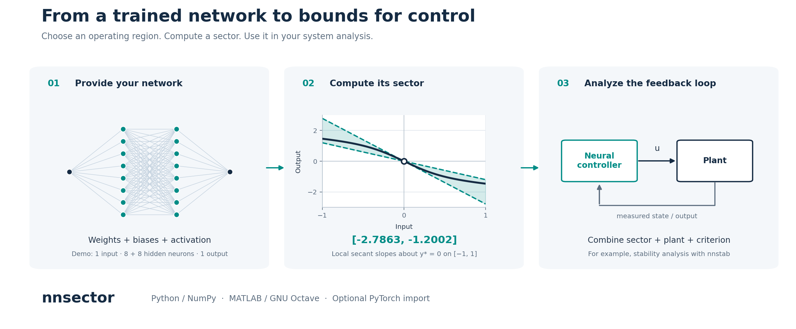
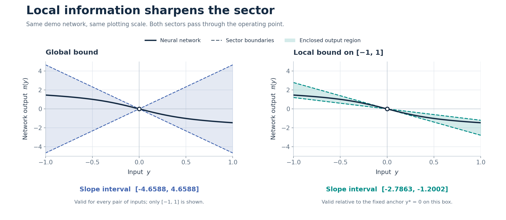
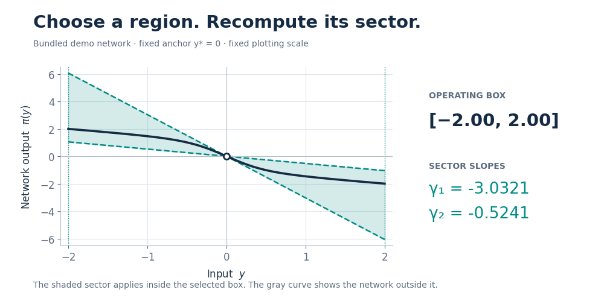
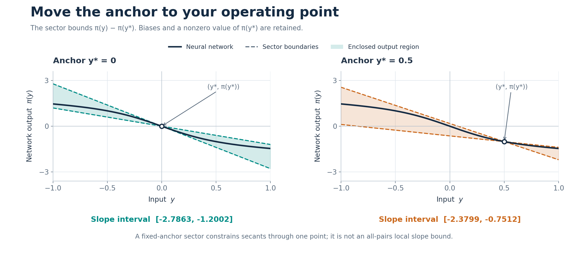
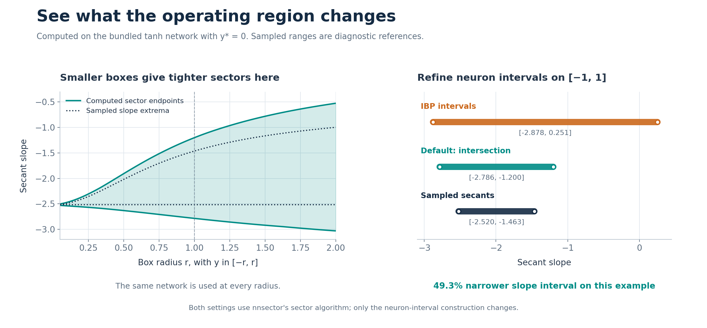
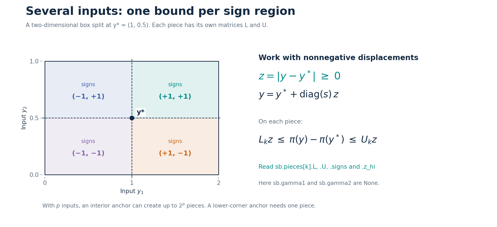

# nnsector

### Sector bounds for neural networks, built for control.

[](https://github.com/hmon91/nnsector/actions/workflows/tests.yml)
[](#installation)
[](#matlab-and-gnu-octave)
[](LICENSE)
[](#citation)

**Turn a trained neural network into a sector description you can use in control analysis.**
Given a feedforward network, an input box, and an operating point, `nnsector`
computes linear bounds on how the network output changes throughout that box.
It also provides global bounds, Python and MATLAB implementations, and an
optional importer for PyTorch models.



[Quick start](#quick-start) · [Your own network](#your-own-network) · [MATLAB](#matlab-and-gnu-octave) · [How it works](#computation-of-the-local-bound) · [Guarantees](#guarantees) · [Examples](#examples-and-tests) · [Citation](#citation)

## Why nnsector?

- **Bounds for control analysis.** Obtain sector matrices for use in suitable absolute-stability, robustness, and region-of-attraction conditions. The companion [nnstab](https://github.com/hmon91/nnstab) library uses these bounds for exponential-stability verification.
- **Choose the region that matters.** Compute a local sector around your operating point, or a global bound valid for all inputs.
- **Keep biases and shifted operating points.** Bound changes relative to the actual network output at the selected point.
- **A lightweight workflow.** The Python core needs NumPy and no optimization solver. Use weights directly or import a supported `torch.nn.Sequential` model.

A sector bound describes the network. A closed-loop stability certificate
also requires the plant dynamics and a stability condition whose assumptions
are satisfied.

## Installation

```bash
python -m pip install git+https://github.com/hmon91/nnsector.git
```

Requires **Python 3.10+** and **NumPy**. PyTorch is needed only for
`Network.from_torch`; Matplotlib is needed only for plotting examples.
For MATLAB or GNU Octave, see [setup below](#matlab-and-gnu-octave).

## Quick start

This example runs immediately with the network included in the package:

```python
import nnsector as ns

net = ns.demo_network()                         # 1 → 8 → 8 → 1, tanh, with biases
sb = ns.local_bound(net, -1.0, 1.0, ystar=0.0)   # local sector on [-1, 1]

print(f"Local sector: [{sb.gamma1.item():.4f}, {sb.gamma2.item():.4f}]")
print("Sample check passed:", ns.check(net, sb).passed)

gb = ns.global_bound(net)                       # bound for all inputs
```

```text
Local sector: [-2.7863, -1.2002]
Sample check passed: True
```

For this single-input network, the result means that every secant from the
fixed operating point has a slope between `sb.gamma1` and `sb.gamma2`:

```math
\gamma_1 \leq \frac{\pi(y)-\pi(0)}{y} \leq \gamma_2,
\qquad y\in[-1,1],\quad y\ne 0.
```

The network was trained to approximate the controller
$`u=-\tanh(2y)-0.5y`$. The following figures evaluate the **actual bundled
network** and use the bounds returned by `nnsector`.



| Calculation | Slope interval, rounded | Scope |
|---|---:|---|
| `global_bound(net)` | `[-4.6588, 4.6588]` | Every pair of inputs |
| `local_bound(net, -1, 1)` | `[-2.7863, -1.2002]` | Fixed anchor `y* = 0`, box `[-1, 1]` |
| Secants evaluated on a dense grid | `[-2.5200, -1.4630]` | Sampled reference, not a proof of the extrema |

`check` searches for violations numerically. A successful sample check is a
useful diagnostic; it does not prove a bound.

<details>
<summary><strong>Watch the sector change as the input box shrinks</strong></summary>



The shaded sector applies only inside the selected box. A
[static view](docs/assets/domain-and-tightness.png) is available below.

</details>

## Your own network

### From NumPy weights

Provide one weight matrix and one bias vector per affine layer. Weights use
the same `(out_features, in_features)` layout as `torch.nn.Linear`.
The final layer is linear; all hidden layers use the same activation.

```python
import numpy as np
import nnsector as ns

net = ns.Network(
    weights=[np.array([[1.0], [-0.7]]), np.array([[1.2, -0.8]])],
    biases=[np.array([0.2, -0.1]), np.array([0.05])],
    activation="tanh",
)

sb = ns.local_bound(net, -1.0, 1.0, ystar=0.25)
print(sb.gamma1, sb.gamma2)
```

Omit `biases` to use zero biases. For a network with `p` inputs and `m`
outputs, `net(y)` accepts one input of shape `(p,)`, or a batch of shape
`(N, p)`, and returns `(m,)` or `(N, m)` respectively.

### From PyTorch

Install PyTorch if needed (`python -m pip install torch`). Then import a
supported sequential model:

```python
import torch.nn as nn
import nnsector as ns

model = nn.Sequential(
    nn.Linear(1, 8), nn.Tanh(),
    nn.Linear(8, 8), nn.Tanh(),
    nn.Linear(8, 1),
)
# Train the model, or load your trained weights, before analyzing it.
model.eval()

net = ns.Network.from_torch(model)
sb = ns.local_bound(net, -1.0, 1.0)
```

The importer copies weights to NumPy double precision. It accepts nested
`nn.Sequential` blocks and merges consecutive `nn.Linear` layers.
`nn.Identity`, `nn.Dropout`, and `nn.Flatten` are skipped under the vector-input,
evaluation-mode interpretation. Hidden activations must all have the same
type and parameters; `nn.Softplus` requires `beta=1`.
Convolutions, residual connections, recurrent layers, and a final activation
are outside this importer's supported model format.

### Supported activations

| `activation` | Function | Global secant-slope range |
|---|---|---|
| `"tanh"` (default) | $`\tanh(x)`$ | $`[0,1]`$ |
| `"sigmoid"` | $`1/(1+e^{-x})`$ | $`[0,1/4]`$ |
| `"relu"` | $`\max(x,0)`$ | $`[0,1]`$ |
| `"leakyrelu"` | $`\max(x,0)+\alpha\min(x,0)`$ | $`[\min(\alpha,1),\max(\alpha,1)]`$ |
| `"softplus"` | $`\log(1+e^x)`$ | $`[0,1]`$ |

Leaky ReLU uses `alpha=0.01` by default and accepts `alpha >= 0`, for example
`ns.Network(weights, biases, activation="leakyrelu", alpha=0.1)`.
The supported activations are nondecreasing; they need not vanish at zero.
Weights may have either sign.

## Choose your operating point and region

`ystar` must lie inside the input box. It defaults to zero, so set it
explicitly when your box does not contain zero.

```python
net = ns.demo_network()
sb = ns.local_bound(net, -1.0, 1.0, ystar=0.5)
print(f"[{sb.gamma1.item():.4f}, {sb.gamma2.item():.4f}]")
# [-2.3799, -0.7512]
```



The local result bounds $`\pi(y)-\pi(y^*)`$ relative to **one fixed anchor**.
It does not establish the same local slope bounds between every pair of
points in the box. Setting `ystar=0` gives a bound relative to $`\pi(0)`$;
this is a sector through the origin only when $`\pi(0)=0`$.



By default, `intervals="intersect"` refines each neuron interval using both
interval bound propagation (IBP) and the propagated linear bounds.
Use `intervals="ibp"` to use only the IBP intervals in this same sector algorithm.
On the demo over `[-1, 1]`, these modes return `[-2.7863, -1.2002]` and
`[-2.8782, 0.2514]`, respectively: a **49.3% reduction in slope-interval width**
for the default mode on this example. This is a comparison of two `nnsector`
settings, not a comparison with another library.

## Several inputs

With several inputs, the sign of each component of $`y-y^*`$ matters.
`nnsector` splits the box at the anchor and computes a bound on each piece.



```python
import numpy as np
import nnsector as ns

net = ns.Network(
    [np.array([[1.0, 0.4], [-0.5, 1.0]]), np.array([[1.2, -0.7]])],
    [np.array([0.1, -0.2]), np.array([0.0])],
    activation="tanh",
)
sb = ns.local_bound(net, [0, 0], [2, 1], ystar=[1, 0.5])

print(len(sb.pieces))                  # 4
print(sb.gamma1 is None)               # True: use the piecewise matrices
for piece in sb.pieces:
    print(piece.signs, piece.L, piece.U)
```

An interior anchor can produce up to $`2^p`$ pieces for `p` inputs. A
lower-corner anchor needs one piece. This sign partitioning is an important
cost consideration for high-dimensional inputs.

## Guarantees

Write $`\Delta y=y-y^*`$ and $`\Delta\pi=\pi(y)-\pi(y^*)`$.
All inequalities and absolute values below are componentwise.
The network has `p` inputs, `m` outputs, `q` hidden layers, and a linear
output layer. The implementation computes its bounds in double precision.

**One input.** For every $`y\ne y^*`$ in the specified box,

```math
\gamma_1\leq\frac{\Delta\pi}{\Delta y}\leq\gamma_2.
```

The boundary lines are $`\pi(y^*)+\gamma_1\Delta y`$ and
$`\pi(y^*)+\gamma_2\Delta y`$. Their ordering as lower and upper output
bounds reverses when $`\Delta y<0`$.

**Several inputs, with the anchor at the lower corner.** Since
$`\Delta y\geq0`$, the returned matrices satisfy

```math
\gamma_1\Delta y\leq\Delta\pi\leq\gamma_2\Delta y.
```

**Several inputs, other anchor positions.** Use `sb.pieces`. On piece `k`,
let $`z=|\Delta y|`$ and let $`s_k`$ be `piece.signs`. For
$`0\leq z\leq\texttt{piece.z\_hi}`$ and
$`y=y^*+\mathrm{diag}(s_k)z`$,

```math
L_kz\leq\Delta\pi\leq U_kz.
```

Here `sb.gamma1` and `sb.gamma2` are `None`; `piece.L` and `piece.U`
have shape `(m, p)`.

**Global bound.** For every pair $`y,y^*`$,

```math
-\Gamma_2|y-y^*|\leq\pi(y)-\pi(y^*)\leq\Gamma_2|y-y^*|,
\qquad
\Gamma_2=c^q|W_{q+1}|\cdots|W_1|,
\qquad \Gamma_1=-\Gamma_2,
```

where $`c`$ is the activation's largest absolute secant slope.
`gb.Gamma1` and `gb.Gamma2` have shape `(m, p)`.
With zero biases and an activation that vanishes at zero (tanh, ReLU, or
leaky ReLU), $`\pi(0)=0`$; for $`y\geq0`$, this specializes to
$`\Gamma_1y\leq\pi(y)\leq\Gamma_2y`$.

## Computation of the local bound

On each sign piece, `nnsector` propagates bounds on deviations from the
operating point through the network:

1. **Evaluate the anchor.** Compute the nominal output and each neuron's nominal preactivation $`\nu^*`$.
2. **Propagate through the weights (S1).** Use the positive and negative parts of each weight matrix to bound preactivation changes by linear functions of $`z=|y-y^*|`$.
3. **Bound each activation (S2).** Enclose the activation change using secant slopes over its preactivation interval. Refine the interval with the linear bounds when `intervals="intersect"`.
4. **Apply the output layer.** Return the matrices $`L_k,U_k`$, and combine the pieces into scalar-input sector slopes when applicable.

Biases cancel from the difference at an affine layer, but still affect the
nominal preactivations and therefore the activation slopes.

<details>
<summary><strong>The three activation cases and returned diagnostics</strong></summary>

For each neuron, the preactivation interval is above $`\nu^*`$ (Case 1),
below $`\nu^*`$ (Case 2), or straddles $`\nu^*`$ (Case 3).
The slope ordering changes on the negative side. In Case 3, the method
uses separate maximum secant slopes on the two sides, together with the
entrywise negative part of the lower linear bound and positive part of the
upper linear bound.

Each `piece.case3` records the number of Case 3 neurons per hidden layer.
This helps explain conservatism: on the demo, `intervals="ibp"` gives
`[0, 8]` per piece, while the default refinement gives `[0, 0]`.

The result also contains `ystar`, `pistar`, `y_lo`, `y_hi`, `intervals`, and
`activation`. Each piece contains `signs`, `z_hi`, `L`, `U`, and `case3`.

</details>

## MATLAB and GNU Octave

Clone or download the repository and add its `matlab` folder to your path.
From the repository root:

```matlab
addpath('matlab')

net = nnsector.demo_network();
sb = nnsector.local_bound(net, -1, 1, 'ystar', 0);
disp([sb.gamma1, sb.gamma2])

gb = nnsector.global_bound(net);
res = nnsector.check(net, sb);
disp(res.passed)
```

Requires **MATLAB R2016b+** or **GNU Octave**. The same local and global
bound forms are available. MATLAB evaluates batches by **columns** using
`nnsector.forward(net, X)`; Python evaluates batches by rows.
See the [MATLAB guide](matlab/README.md) for custom networks, options,
examples, and tests.

## API at a glance

| Function | Purpose |
|---|---|
| `Network(weights, biases=None, activation="tanh", alpha=None)` | Define a network from arrays. |
| `Network.from_torch(model)` | Import a supported sequential PyTorch model. |
| `local_bound(net, y_lo, y_hi, ystar=None, intervals="intersect")` | Compute a local sector on an input box. Scalar box endpoints and anchors broadcast to every input. |
| `global_bound(net)` | Compute a bound valid for every pair of inputs. |
| `check(net, bound, samples=20000, box=None, ystar=None, seed=0)` | Search sample points for bound violations. For a global bound, supply `box=(y_lo, y_hi)`. |
| `demo_network()` | Load the bundled trained tanh network. |

## Examples and tests

| Example | What you will learn |
|---|---|
| [Demo network](examples/example1_demo.py) | Local and global bounds, shifted anchors, and plotting. |
| [Biases and multiple inputs](examples/example2_biases.py) | Bound biased networks and inspect sign pieces. |
| [Activation functions](examples/example3_activations.py) | Apply the supported activations to the demo weights. |
| [PyTorch controller](examples/example4_pytorch.py) | Train a small controller and compute its sector. |
| [README figures](docs/make_readme_figures.py) | Reproduce the figures and their numerical data. |

For development:

```bash
git clone https://github.com/hmon91/nnsector.git
cd nnsector
python -m pip install -e ".[test,examples]"
pytest
python examples/example1_demo.py
```

The tests check the demo's numerical results, compare activation secant
ranges against dense evaluations, and sample bounds for networks with
biases and different input dimensions. PyTorch-specific tests require
PyTorch.

To regenerate the README figures from a development checkout:

```bash
python -m pip install pillow
python docs/make_readme_figures.py
```

Static figures are provided as **PNG and SVG**, together with an animated
GIF. See [figure notes and data](docs/FIGURES.md).

## Related tools

[auto_LiRPA](https://github.com/Verified-Intelligence/auto_LiRPA) provides
linear-relaxation bound propagation on general PyTorch computational graphs.
`nnsector` focuses on sector descriptions of feedforward networks around
operating points, with a small NumPy core and a MATLAB implementation.
[nnstab](https://github.com/hmon91/nnstab) connects these sector bounds to
stability verification of neural-network feedback systems.

## Citation

If you use `nnsector` in your research, please cite:

H. Montazeri Hedesh, M. K. Wafi, and M. Siami,
**“Local Stability and Region of Attraction Analysis for Neural Network
Feedback Systems under Positivity Constraints,”**
*2025 IEEE 64th Conference on Decision and Control (CDC)*,
Rio de Janeiro, Brazil, 2025.
[DOI: 10.1109/CDC57313.2025.11312171](https://ieeexplore.ieee.org/document/11312171) ·
[Preprint: arXiv:2505.22889](https://arxiv.org/abs/2505.22889)

```bibtex
@inproceedings{montazerihedesh2025local,
  author    = {Montazeri Hedesh, Hamidreza and Wafi, Moh Kamalul and Siami, Milad},
  title     = {Local Stability and Region of Attraction Analysis for Neural Network
               Feedback Systems under Positivity Constraints},
  booktitle = {2025 IEEE 64th Conference on Decision and Control (CDC)},
  year      = {2025},
  doi       = {10.1109/CDC57313.2025.11312171}
}
```

## Contributing and license

Questions, reproducible bug reports, and examples are welcome in
[GitHub Issues](https://github.com/hmon91/nnsector/issues).
`nnsector` is released under the [BSD 3-Clause License](LICENSE).
